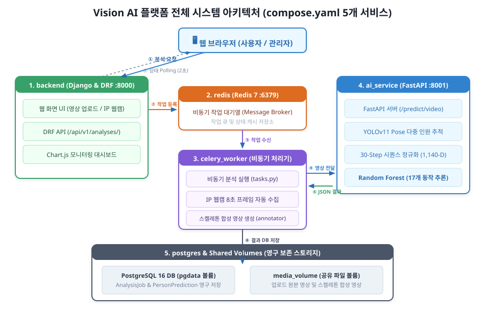
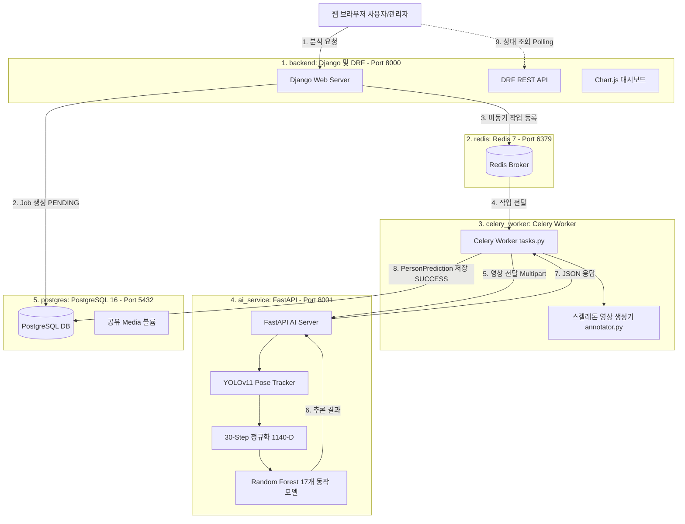
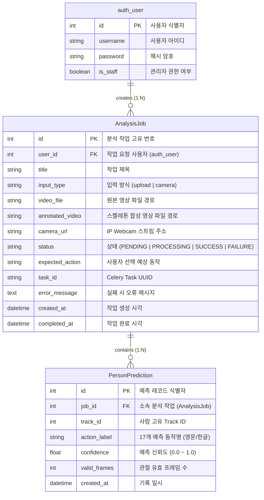
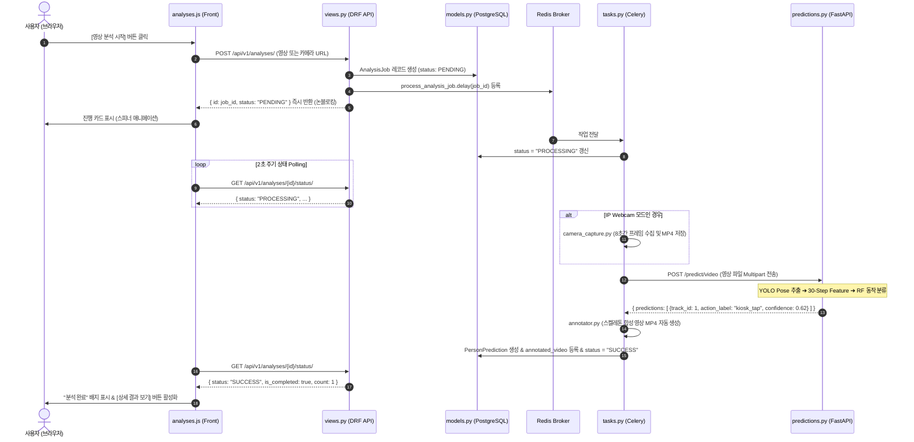

# Vision AI 동작 추론 자율 플랫폼 (Vision Action Platform)

> **교과10 자세추정 및 동작분석 최종 프로젝트**  
> 영상 파일 및 실시간 IP Webcam 스트림에서 사람의 다중 관절(YOLO Pose)을 추출하고, 30-Step 시퀀스 및 운동학 요약 특징(총 1,226차원 Feature)로 변환하여 17개 이상 행동 및 일상 동작을 실시간 추론·시각화하는 엔드투엔드 AI 웹 서비스입니다.

---

## 1. 프로젝트 소개

본 플랫폼은 무인 매장, 작업장, 공공장소 등에서 발생하는 사람의 다양한 행동과 이상 징후를 Vision AI 기술로 자동 감지하고 관리자에게 신속히 전달하기 위해 개발된 시스템입니다. 

사용자는 **사전 녹화된 영상 파일 업로드** 방식과 **스마트폰 IP Webcam 실시간 스트리밍** 방식의 두 가지 입력을 통해 손쉽게 분석을 요청할 수 있습니다. 

분석이 완료되면 웹 화면에서 **영상 속 사람별(Track ID) 예측 동작 라벨(한글 명칭), 신뢰도(Confidence %), 관절 유효 프레임 수**를 확인할 수 있으며, 사람의 17개 관절 뼈대와 바운딩 박스가 움직임을 따라다니며 합성된 **스켈레톤 분석 영상 재생 및 다운로드** 기능을 제공합니다.

---

## 2. 실행 방법

저장소를 복제한 후 Docker 환경에서 원클릭으로 5개 마이크로서비스를 구동할 수 있습니다.

### 1) 환경변수 파일 복사
```bash
cp .env.example .env
```

### 2) AI 모델 파일 위치 확인
모델 파일들은 각 서비스의 모델 디렉터리에 배치되어야 합니다:
- **FastAPI AI 서빙 모델**: `ai_service/models/`
  - `rf_action_motion_capture_full.joblib` (17개 동작 Random Forest 모델)
  - `yolo11m-pose.pt` (YOLOv11 Pose 추정 모델)
  - `rf_feature_columns.json`, `rf_training_info.json`
- **Django 및 Celery 실시간 시각화 모델**: `yolov8n-pose.pt` (루트 디렉터리)

### 3) Docker Compose 통합 빌드 및 백그라운드 실행
```bash
docker compose up --build -d
```

### 4) 데이터베이스 마이그레이션 적용
```bash
docker compose exec backend python manage.py migrate
```

### 5) 관리자(Superuser) 계정 생성
```bash
docker compose exec backend python manage.py createsuperuser
# 사용자명: admin / 비밀번호 입력 (예: 1234)
```

### 6) 서비스 접속 주소
- **사용자 분석 메인 화면**: [http://localhost:8000/analyses/](http://localhost:8000/analyses/)
- **관리자 모니터링 대시보드**: [http://localhost:8000/analyses/dashboard/](http://localhost:8000/analyses/dashboard/)
- **Django 백오피스 관리자**: [http://localhost:8000/admin/](http://localhost:8000/admin/)
- **FastAPI Swagger API 문서**: [http://localhost:8001/docs](http://localhost:8001/docs)

---

## 3. 전체 아키텍처

본 시스템은 **`compose.yaml`로 오케스트레이션되는 5개의 독립 컨테이너 서비스**로 구성되어 있습니다.



<details>
<summary>🔍 <strong>Mermaid 다이어그램 코드 펼치기</strong></summary>



---

</details>

---

## 4. DB 설계 (ERD)

데이터베이스 모델 코드는 **`backend/analyses/models.py`**에 정의되어 있으며, 사용자의 분석 요청과 영상 내 다중 인원의 추론 결과를 **1:N 관계**로 완벽하게 분리 설계했습니다.



* **`auth_user`**: Django 표준 사용자 테이블로, 일반 사용자와 관리자(`is_staff`) 권한을 분리합니다.
* **`AnalysisJob`**: 1건의 분석 요청 메타데이터(요청자, 입력 방식, 원본/스켈레톤 영상, 진행 상태)를 저장합니다.
* **`PersonPrediction`**: 한 영상에서 2명 이상의 사람이 감지되었을 때, 작업 1건에 각 사람(`Track ID`)별 동작과 신뢰도를 1:N으로 기록합니다.

---

## 5. AI 추론 버튼 구현 흐름

사용자가 웹 브라우저에서 **[영상 분석 시작]** 또는 **[스트림 수집 및 분석 시작]** 버튼을 클릭했을 때 일어나는 전체 비동기 파이프라인 흐름입니다.



---

## 6. 사용한 모델과 입력 형식

### 1) 사용한 AI 모델 및 파일 규격
- **자세 추정(Pose) 모델**: `yolo11m-pose.pt` (YOLOv11 Pose 추정기, COCO 17개 관절 추출)
- **동작 분류(Action) 모델**: `rf_action_motion_capture_full.joblib` (Random Forest 분류기, 1,000 Trees, 각도 불변 정규화 및 1,226차원 운동학 특징 적용)
- **실시간 화면 시각화 모델**: `yolov8n-pose.pt` (초경량 실시간 스켈레톤 오버레이용)

### 2) 지원하는 17개 동작 클래스
우리 팀이 직접 촬영 및 모션 캡처하여 학습시킨 17개 동작을 식별합니다:
1. `kiosk_tap` (키오스크 내려치기, A001)
2. `throw_one_hand` (한손 물건 던지기, A002)
3. `front_kick` (앞차기, A003)
4. `grab_shake` (잡고 흔들기, A004)
5. `push` (밀치기, A005)
6. `swing` (휘두르기, A006)
7. `sit_floor` (바닥에 앉기, A007)
8. `sit_on_object` (위에 앉기, A008)
9. `lie_forward` (앞으로 눕기, A009)
10. `lie_backward` (뒤로 눕기, A010)
11. `body_slam` (몸통 박치기, A011)
12. `crouch_take_item` (쪼그려 물건 빼내기, A012)
13. `shotgun` (샷건, A013)
14. `vomit` (구토, A014)
15. `fall_sideways` (옆으로 쓰러지기, A015)
16. `fall_backward` (뒤로 넘어지기, A016)
17. `fall_forward` (앞으로 넘어지기, A017)

### 3) 영상 입력 형식 및 IP Webcam 수집 기준
- **업로드 영상 형식**: `.mp4`, `.avi`, `.mov`, `.mkv` 지원
- **IP Webcam 수집 시간**: 버튼 클릭 시 연결되어 **정확히 8초(`duration_sec = 8`)** 동안 실시간 수집 (`camera_capture.py`)

### 4) FastAPI 입출력 명세
- **입력 (Request)**: `POST /predict/video` (Multipart/form-data `file: video.mp4`)
- **출력 (Response JSON)**:
  ```json
  {
    "status": "success",
    "filename": "S05_A001_T01.mp4",
    "person_count": 1,
    "predictions": [
      {
        "track_id": 1,
        "action_label": "kiosk_tap",
        "confidence": 0.62,
        "valid_frames": 366
      }
    ],
    "processing_time": 2.14
  }
  ```

---

## 7. 실행 결과와 검증

### 사례 1. 정상 분석 결과 (영상 파일 업로드)
* **입력**: `S05_A001_T01.mp4` 비디오 파일 업로드
* **분석 결과**: 사람 1명 검출 (`Track #1`), 예측 동작 **`키오스크 내려치기 (A001) (kiosk_tap)`**, 신뢰도 **62.0%**, 유효 관절 프레임 366 frames.
* **시각화**: 상세 화면에서 [스켈레톤 영상] 탭 클릭 시 17개 관절선과 예측 라벨이 합성된 영상 재생 및 다운로드 성공.

### 사례 2. 오류 및 실패 안전 처리 (IP Webcam)
* **입력**: 스마트폰 앱이 켜지지 않은 상태에서 IP Webcam 연결 테스트 또는 분석 요청
* **처리 결과**: 서버 크래시 없이 즉시 예외를 감지하여 `"카메라에 연결할 수 없습니다. URL 주소 및 Wi-Fi 연결을 확인해 주세요."`라는 사용자 친화적 오류 메시지를 표시하고 DB에 `FAILURE` 상태 안전 기록.
* **보안 차단**: 외부 악성 도메인(`http://evil.com`) 입력 시 사설망 IP 제한 정책(`serializers.py`)에 의해 사전에 즉시 차단.

### 사례 3. 관리자 모니터링 대시보드 검증
* **접속**: `admin` 계정으로 `/analyses/dashboard/` 접속 (일반 사용자는 HTTP 403 차단)
* **표시 지표**:
  - 4대 KPI 카드: 총 분석 요청 건수, 성공률(%), 검출된 총 사람 수, 평균 예측 신뢰도
  - Chart.js 시각화: 17개 동작별 분포 도넛 차트(한글 동작 라벨 표시), 입력 방식별(업로드 vs IP웹캠) 비율 막대 차트
  - 실시간 최근 작업 통합 테이블 목록 제공
